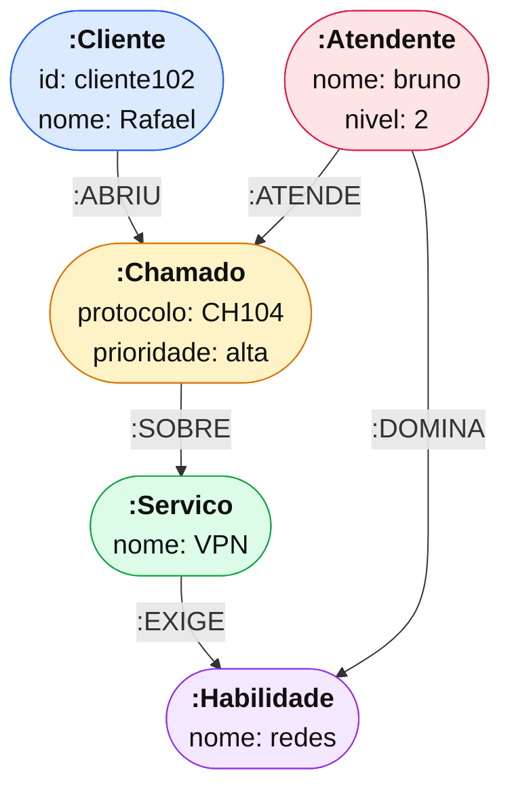
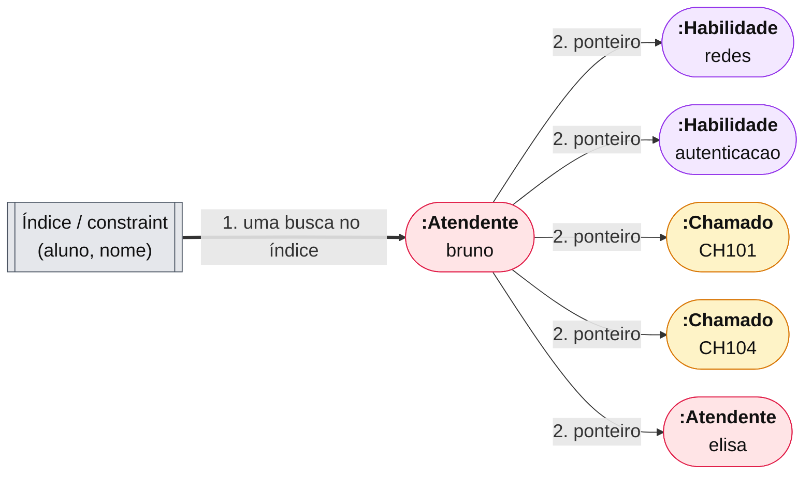
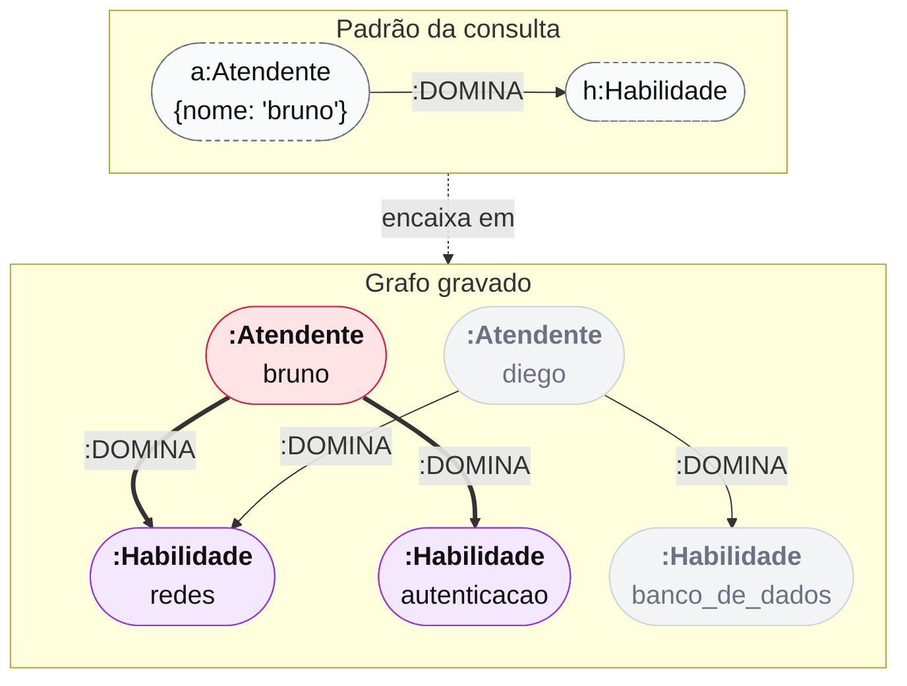
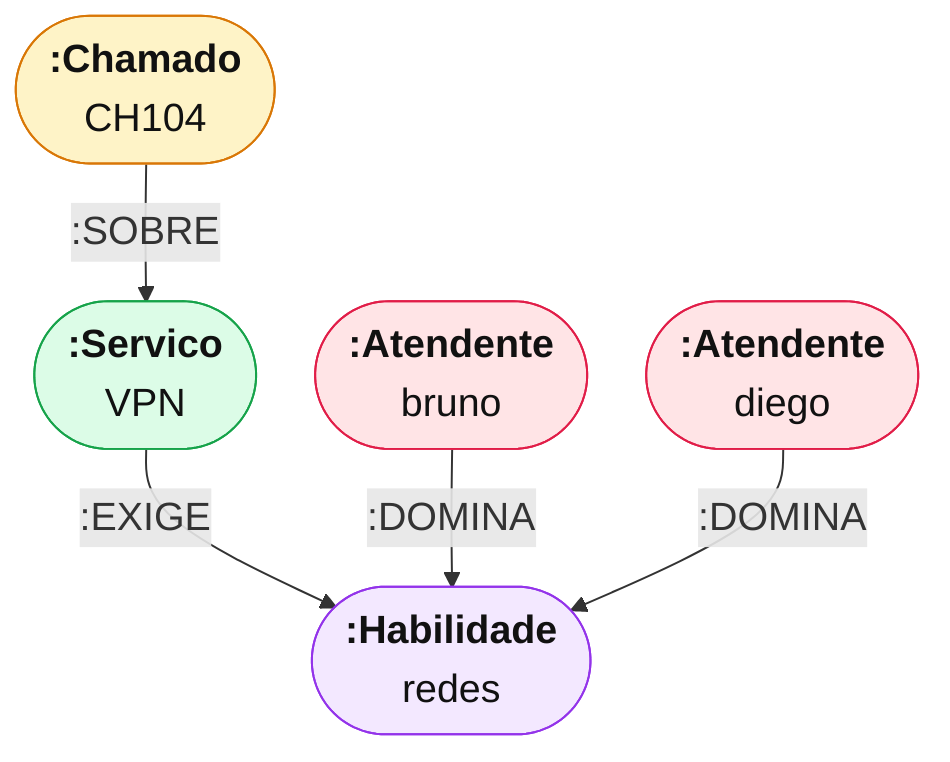
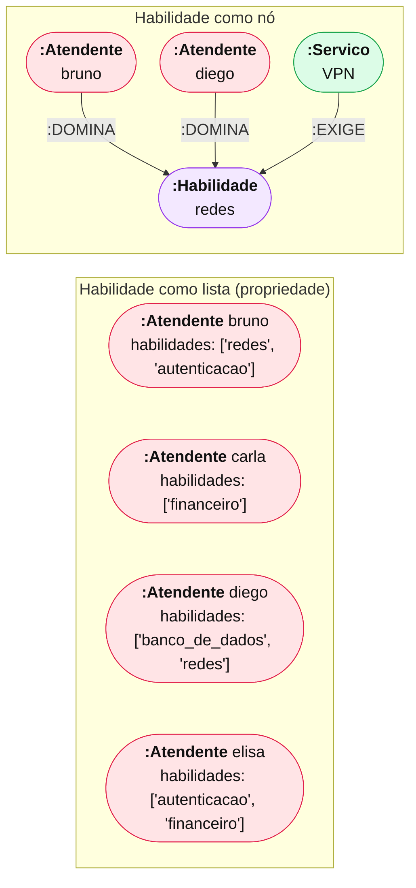
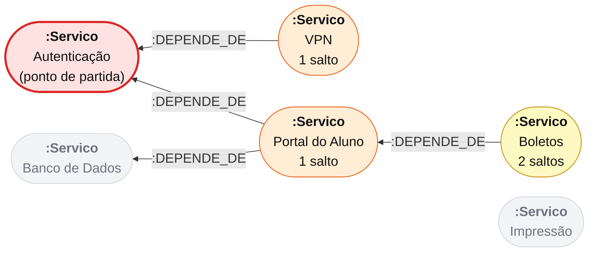
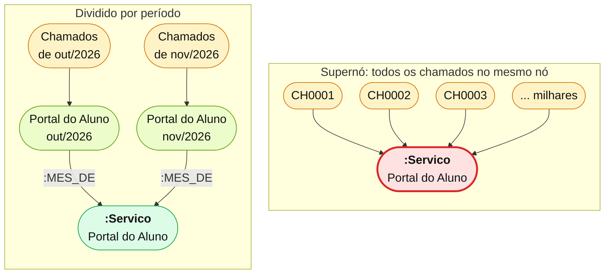
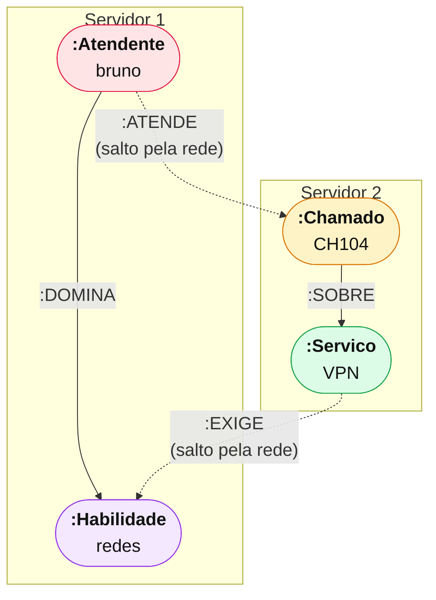
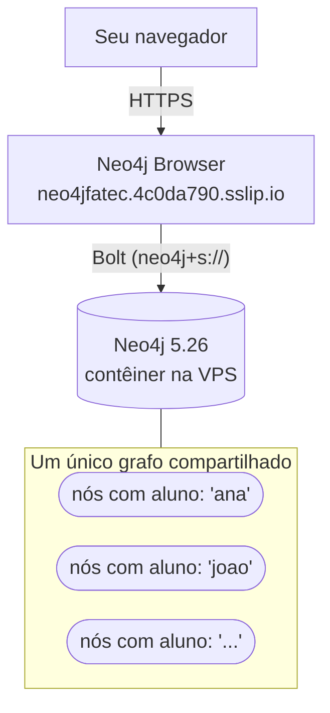

# 8.1 Banco orientado a grafos e Neo4j

Até aqui, o sistema de chamados foi modelado em documentos no MongoDB, teve sessões e contadores no Redis e guardou o histórico de eventos no Cassandra. Em todos esses modelos, as ligações entre os dados ficaram em segundo plano: referências resolvidas pela aplicação, convenções de nomes de chaves ou dados duplicados em outra tabela.

Agora vamos atender a perguntas em que a ligação é o próprio dado: **se o serviço de autenticação cair, quais outros serviços param? Quem pode atender este chamado? Que artigo ajudou em casos parecidos?**

A pergunta desta aula é: **como modelar e consultar dados quando o mais importante são as conexões entre eles?**

## 1. Objetivos e roteiro

### Ao final da aula, você será capaz de

- **Representar dados** como nós, relacionamentos e propriedades.
- **Consultar padrões e caminhos** em Cypher, inclusive de tamanho variável.
- **Avaliar o modelo:** custo das travessias, supernós e limites de distribuição.

### Nosso percurso

1. **Entender:** o grafo de propriedades e a comparação com os modelos estudados.
2. **Modelar:** serviços, dependências, atendentes e habilidades do sistema de chamados.
3. **Consultar:** padrões, agregações, caminhos variáveis e menor caminho.
4. **Decidir:** quando um grafo compensa e quando outro modelo atende melhor.

## 2. Modelo de grafo de propriedades

Um banco orientado a grafos guarda dois tipos de elementos:

| Elemento | O que representa | Exemplo |
|---|---|---|
| **Nó** | Uma entidade | O atendente `bruno`, o serviço `VPN` |
| **Rótulo** (*label*) | O tipo do nó; um nó pode ter mais de um | `:Atendente`, `:Servico` |
| **Relacionamento** | Uma ligação com tipo e direção entre dois nós | `(bruno)-[:DOMINA]->(redes)` |
| **Propriedade** | Um par chave-valor em um nó ou relacionamento | `nivel: 2`, `desde: 2026-11-03` |



Como ler o desenho:

- Cada **forma arredondada** é um nó. A primeira linha, em negrito, é o rótulo; as demais são propriedades.
- Cada **seta** é um relacionamento, com tipo (`:ABRIU`, `:DOMINA`...) e direção.
- As **cores** indicam o rótulo e são usadas da mesma forma em todos os diagramas desta aula.

O atendente `bruno` atende o chamado `CH104` e domina `redes`, a habilidade que o serviço `VPN` exige. Cada seta é um relacionamento gravado no banco.

Três características diferenciam esse modelo:

- **O relacionamento é guardado como dado**, com tipo, direção e propriedades próprias. Não é uma chave estrangeira resolvida no momento da consulta.
- **Todo relacionamento liga dois nós existentes.** Não há relacionamento "pendurado", apontando para um nó que não existe.
- **Não há esquema obrigatório.** Dois nós com o mesmo rótulo podem ter propriedades diferentes. Restrições, como unicidade, são acrescentadas quando necessário.

A direção é gravada sempre, mas pode ser ignorada na consulta. `(bruno)-[:DOMINA]->(redes)` pode ser lido nos dois sentidos: "o que bruno domina?" e "quem domina redes?".

### Adjacência sem índice

No Neo4j, cada nó guarda referências diretas aos seus relacionamentos, e cada relacionamento guarda referências aos dois nós que liga. Essa organização é chamada de **adjacência sem índice** (*index-free adjacency*).

Uma forma de entender: em um prédio, você chega ao primeiro andar procurando o endereço na lista do porteiro (o índice). Dali em diante, você segue pelas portas que ligam um cômodo ao outro, sem voltar ao porteiro a cada passo.



O índice é consultado **uma vez**, para achar `bruno`. Os vizinhos de `bruno` são alcançados pelos ponteiros que o próprio nó guarda, sem nova busca no índice e sem examinar os outros atendentes ou chamados do banco.

| Etapa da consulta | Como o banco trabalha | Custo |
|---|---|---|
| Encontrar o ponto de partida | Índice ou constraint, como `(aluno, nome)` do atendente | Uma busca no índice |
| Seguir os relacionamentos | Ponteiros do nó para seus vizinhos | Proporcional ao que é percorrido, não ao tamanho do banco |

**Uma consulta em grafo é eficiente quando parte de poucos nós conhecidos e percorre uma vizinhança limitada.** A prática 8.4 mede esse comportamento.

## 3. Comparação com os modelos estudados

| Aspecto | MongoDB | Redis | Cassandra | Neo4j |
|---|---|---|---|---|
| Organização | Coleções e documentos | Chaves e estruturas | Tabelas, partições e linhas | Nós, relacionamentos e propriedades |
| Ponto de partida da modelagem | Dados usados em conjunto | Operação sobre uma chave | Consulta que a tabela responde | Perguntas sobre conexões |
| Dados relacionados | Embedded ou referência, com `$lookup` | Convenção de nomes de chaves | Duplicação em outra tabela | Relacionamento gravado como dado |
| Consulta típica | Filtro por campos | Leitura por chave | Leitura de uma partição | Padrão ou caminho a partir de um nó |
| Linguagem | Comandos do `mongosh` | Comandos do Redis | CQL | Cypher |
| Transações | Em documento; multidocumento com custo | Por comando ou `MULTI` | Leves e limitadas | ACID, com várias operações |
| Distribuição dos dados | Sharding | Redis Cluster | Partições pelo anel de tokens | Difícil; geralmente replicação |
| Cliente usado | Compass e `mongosh` | Redis Insight | DbGate | Neo4j Browser |

Repare na linha das transações: o Neo4j oferece transações ACID completas, como um banco relacional. Ser "NoSQL" não implica abrir mão de transações; implica um modelo de dados diferente do relacional.

## 4. Cypher: consultas desenhadas como padrões

O Cypher descreve o que procurar com um desenho em texto: parênteses são nós e setas são relacionamentos.

```cypher
MATCH (a:Atendente {nome: 'bruno'})-[:DOMINA]->(h:Habilidade)
RETURN h.nome
```

| Trecho | Significado |
|---|---|
| `(a:Atendente {nome: 'bruno'})` | Um nó com rótulo `Atendente` e propriedade `nome` igual a `bruno`, chamado `a` na consulta |
| `-[:DOMINA]->` | Um relacionamento do tipo `DOMINA`, saindo de `a` |
| `(h:Habilidade)` | O nó de destino, chamado `h` |
| `RETURN h.nome` | O que será devolvido |

O banco procura, no grafo, todos os trechos com o mesmo desenho do padrão. Com os dados do material 8.2, o padrão "encaixa" em dois lugares (setas grossas) e a consulta devolve `redes` e `autenticacao`. As setas finas não fazem parte do resultado:



As principais cláusulas usadas nesta aula:

| Cláusula | Função | Equivalente aproximado |
|---|---|---|
| `MATCH` | Procura um padrão | `find` no MongoDB, `SELECT ... FROM` no SQL |
| `WHERE` | Filtra o padrão encontrado | `WHERE` |
| `RETURN` | Define o resultado | Lista de colunas do `SELECT` |
| `CREATE` | Cria nós e relacionamentos, sempre | `insertOne` |
| `MERGE` | Encontra o padrão ou o cria se não existir | `updateOne` com `upsert: true` |
| `SET` / `REMOVE` | Altera ou remove propriedades | `$set` / `$unset` |
| `DELETE` / `DETACH DELETE` | Remove relacionamentos e nós | `deleteOne` |

Em 2024, a ISO publicou a **GQL** (ISO/IEC 39075), primeira linguagem padrão para bancos de grafos desde o SQL. Ela foi baseada no Cypher, e por isso o que se aprende aqui vale além do Neo4j.

## 5. Modelar a partir das perguntas sobre conexões

No Cassandra, cada consulta gerava uma tabela. No grafo, as perguntas indicam quais **ligações** precisam existir e em que direção percorrê-las.

| Pergunta da aplicação | Padrão percorrido |
|---|---|
| Quais chamados um cliente abriu? | `(Cliente)-[:ABRIU]->(Chamado)` |
| Quem pode atender um chamado? | `(Chamado)-[:SOBRE]->(Servico)-[:EXIGE]->(Habilidade)<-[:DOMINA]-(Atendente)` |
| Se um serviço cair, quais outros param? | `(Servico)-[:DEPENDE_DE*]->(Servico)` |
| Que artigo ajudou em casos parecidos? | `(Chamado)-[:SOBRE]->(Servico)<-[:TRATA_DE]-(Artigo)` |

Veja a segunda pergunta desenhada sobre os dados. Partindo do chamado `CH104`, o caminho chega à habilidade `redes` e, de lá, "volta" contra a seta `:DOMINA` até os atendentes que a dominam:



Resposta: `bruno` e `diego`. Foram três saltos a partir de um nó conhecido, sem examinar os demais chamados nem os outros atendentes.

Algumas regras práticas:

| Situação | Decisão |
|---|---|
| Substantivo que tem identidade e é procurado ou ligado a outros | Nó: `Servico`, `Atendente` |
| Verbo que liga duas entidades | Relacionamento: `DOMINA`, `DEPENDE_DE` |
| Característica que só descreve algo | Propriedade: `prioridade`, `nivel` |
| Informação sobre a ligação, e não sobre os nós | Propriedade do relacionamento: `ATENDE {desde}` |
| Valor que vários nós compartilham e pelo qual se navega | Promover a nó: `Habilidade` em vez de uma lista dentro do atendente |

A última linha é a decisão mais típica do modelo. Se as habilidades fossem uma lista de textos dentro de cada atendente, a pergunta "quem domina redes?" exigiria examinar todos os atendentes. Como nó, `redes` conhece seus vizinhos diretamente.



À esquerda (lista), "quem domina redes?" obriga a abrir os quatro atendentes e procurar o texto em cada lista; não há ligação com o serviço `VPN`. À direita (nó), basta encontrar `redes` e ler seus vizinhos: os atendentes que a dominam e os serviços que a exigem.

**No grafo, uma boa modelagem é aquela em que as perguntas importantes viram caminhos curtos a partir de um nó fácil de encontrar.**

### Comparação com embedded, referência e tabelas

| Modelo | Como ligaria um chamado ao seu serviço |
|---|---|
| MongoDB embedded | Cópia dos dados do serviço dentro do chamado |
| MongoDB referência | Campo `servico_id`, resolvido pela aplicação ou por `$lookup` |
| Cassandra | Nome do serviço repetido na tabela de cada consulta |
| Relacional | Chave estrangeira e `JOIN` na leitura |
| Grafo | Relacionamento `SOBRE`, percorrido por ponteiro |

## 6. Caminhos de tamanho variável

O recurso que mais diferencia o grafo é percorrer um número de saltos que não se conhece de antemão:

```cypher
MATCH (s:Servico)-[:DEPENDE_DE*1..3]->(:Servico {nome: 'Autenticação'})
RETURN DISTINCT s.nome
```

`*1..3` significa "de um a três relacionamentos `DEPENDE_DE` seguidos". A consulta encontra quem depende diretamente da autenticação e também quem depende de quem depende.

Com as dependências criadas no material 8.2, a consulta percorre o grafo assim:



| Serviço | Caminho até `Autenticação` | Saltos | Devolvido? |
|---|---|---|---|
| `VPN` | `VPN → Autenticação` | 1 | Sim |
| `Portal do Aluno` | `Portal do Aluno → Autenticação` | 1 | Sim |
| `Boletos` | `Boletos → Portal do Aluno → Autenticação` | 2 | Sim, embora não dependa diretamente |
| `Banco de Dados` | Nenhum: a seta sai do Portal e chega ao Banco de Dados | — | Não |
| `Impressão` | Nenhum: não tem dependências | — | Não |

Se a autenticação cair, param a VPN e o Portal do Aluno e, por consequência do Portal, os Boletos. Uma consulta com `-[:DEPENDE_DE]->` (um salto só) deixaria `Boletos` de fora.

| Escrita | Significado |
|---|---|
| `-[:R*2]->` | Exatamente dois saltos |
| `-[:R*1..3]->` | De um a três saltos |
| `-[:R*0..2]->` | Zero a dois saltos; zero inclui o próprio nó de origem |
| `-[:R*]->` | Qualquer número de saltos: use só quando o grafo é pequeno ou a estrutura é conhecida |

No modelo relacional, essa pergunta exige uma consulta recursiva (`WITH RECURSIVE`), como mostra o material 8.5.

## 7. Cuidados do modelo

| Risco | O que acontece | Como evitar |
|---|---|---|
| Consulta sem ponto de partida | O banco examina todos os nós de um rótulo, ou do banco inteiro | Começar por uma propriedade com índice ou constraint |
| Caminho sem limite | O número de caminhos cresce muito a cada salto | Limitar os saltos e o tipo de relacionamento |
| **Supernó** | Um nó com milhares de relacionamentos torna caras as travessias que passam por ele | Filtrar antes de passar pelo nó, ou dividir o nó (por exemplo, por período) |
| Relatórios globais | Somas e contagens sobre todo o grafo não usam a adjacência | Avaliar se outro banco atende melhor ao relatório |

O supernó é o equivalente, no grafo, à partição grande do Cassandra: um ponto onde os dados se concentram e o custo deixa de ser previsível.



Na versão dividida, uma consulta sobre os chamados de novembro passa só pelo nó `nov/2026` e não examina os relacionamentos de todos os outros meses.

### Por que é difícil distribuir um grafo

Nos módulos 5, 6 e 7, os dados foram divididos entre servidores por uma chave: shard key, nome da chave e chave de partição. Um grafo não tem um corte natural. Se `bruno` ficar em um servidor e os chamados que ele atende em outro, cada salto da travessia se torna uma chamada de rede, e a vantagem da adjacência desaparece.



As setas tracejadas cruzam de um servidor para outro. A pergunta "quem pode atender o CH104?" passaria duas vezes pela rede, em vez de seguir ponteiros na memória.

Por isso, a forma mais comum de escalar um banco de grafos é **replicar** o grafo inteiro em vários servidores para distribuir as leituras, e não dividi-lo. Dividir um grafo é possível quando ele tem partes pouco conectadas entre si, como dados de clientes diferentes, mas essa divisão exige planejamento e limita as consultas entre as partes.

## 8. Ambiente do laboratório

O Neo4j da aula já está em execução na VPS do professor, a mesma dos módulos anteriores, e é usado pelo navegador, sem instalação. As formas de acesso estão no material 8.2.



| Configuração | Valor | Consequência |
|---|---|---|
| Versão | Neo4j 5.26 Community | Versão de suporte estendido, com Cypher 5 |
| Instância | Uma só, sem cluster | A distribuição é estudada pelos conceitos, não na prática |
| Banco de dados | Um único grafo, compartilhado por todos | A edição Community não cria bancos separados por aluno |
| Separação entre alunos | Propriedade `aluno` em todos os nós | Toda consulta começa filtrando pelo seu identificador |
| Restrições | Unicidade de `(aluno, chave)` por rótulo, criadas pelo professor | O mesmo `bruno` pode existir uma vez para cada aluno |
| Permissões | A edição Community não tem perfis de acesso | A conta `aluno` aceita qualquer comando; use somente os do material |

A propriedade `aluno` cumpre o papel que o keyspace cumpria no Cassandra. A diferença é que ela não é uma fronteira do banco: uma consulta que esqueça o filtro enxerga os dados de toda a turma, e uma remoção sem filtro apaga o trabalho de todos.

## 9. Quando usar e quando evitar

| Bom encaixe | Mau encaixe |
|---|---|
| Dependências entre serviços, componentes ou tarefas | Dados sem relações relevantes entre si |
| Recomendação: "quem viu isto também viu" | Relatórios com somas sobre todos os registros |
| Detecção de fraude por ligações entre contas, cartões e aparelhos | Grandes volumes de eventos com consulta por chave e período |
| Redes sociais, organogramas e controle de acesso por hierarquia | Cache e dados temporários de acesso muito rápido |
| Perguntas com número de saltos variável | Necessidade de distribuir escritas entre muitos servidores |

No sistema de chamados, os bancos podem trabalhar juntos: o MongoDB como fonte principal dos chamados, o Redis para sessões e cache, o Cassandra para o histórico de eventos e o Neo4j para o mapa de dependências entre serviços e a recomendação de atendentes e artigos.

## 10. Perguntas para discussão

1. Por que `Habilidade` foi modelada como nó, e não como uma lista de textos dentro de cada atendente?

   **Sugestão de resposta:** para navegar por ela: como nó, `redes` liga direto quem a domina e os serviços que a exigem.

2. Que informação faz sentido guardar no relacionamento `ATENDE`, e não nos nós?

   **Sugestão de resposta:** dados da ligação, como data de início, tempo gasto ou papel no chamado.

3. Uma consulta parte de um atendente, encontrado pela constraint, e percorre seus chamados. O que acontece com o custo se o banco passar de mil para um milhão de chamados, sem que esse atendente receba novos chamados?

   **Sugestão de resposta:** quase nada; o custo depende da vizinhança percorrida, não do tamanho do banco.

4. Por que `-[*]-`, sem tipo e sem limite, é perigoso mesmo em um grafo pequeno?

   **Sugestão de resposta:** o número de caminhos explode a cada salto, consumindo tempo e memória.

5. O serviço `Portal do Aluno` aparece em milhares de chamados. Que problema isso cria e como poderia ser reduzido?

   **Sugestão de resposta:** vira um supernó; reduza filtrando antes de passar por ele ou dividindo-o por período.

6. Por que é mais difícil distribuir um grafo entre servidores do que distribuir as partições do Cassandra?

   **Sugestão de resposta:** não há chave que separe o grafo sem cortar caminhos; cada salto entre servidores vira tráfego de rede.

